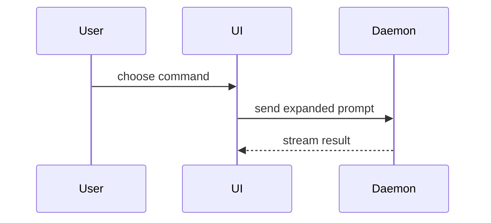

<!-- Based on mattpocock-skills 1.3.1 `engineering/pr` (MIT, see LICENSE; Summary visuals from show-me, see CREDITS.md). Adapted for sop-recorder and owned by this repo: edit it here. Upstream changes are compared by hand, never copied over. -->

The PR body exists so the owner can review fast and spend review time where it matters. Write it from the diff and from commands you actually ran. Never write a claim you didn't run.

**This repo is public.** The title and body carry no customer, pilot, pricing or internal-host detail, and nothing from the private server repo. The server is named only through `docs/server-contract.md`.

**Title:** a Conventional Commit, because it becomes the squash commit: `fix: ...`, `feat(<area>): ...`, `docs: ...`, `chore: ...`.

Use this template for the body:

```markdown
## Summary

<diagram, diff-sketch, or tree>

## Evidence

- **Before:** <failing test run or error output on the base>
  **After:** <the same test passing on this branch, or the green `ci` check>

## Hands-on check

**Windows:** <needed or not needed>: <why, and the `docs/manual-tests/` fixture if one fits>
**macOS:** <needed or not needed>: <why>

## Not verified here

<each check this session could not run, and who runs it; or "nothing">

## Changelog

<the line added under `## [Unreleased]` in CHANGELOG.md, or "none: not user-visible">

## Merge Danger

**Door:** <one-way or two-way>: <the reason, one line>

**Blast Radius:** <one word>

<optional: what breaks, for whom, if this is wrong>

Closes #<issue>
```

## Sections

Skip all preambles and keep prose brief. Use the terms of `docs/ARCHITECTURE.md` and `docs/server-contract.md` (recording, step, screenshot, upload, ...). Quote German UI strings as they appear, with real umlauts.

### Summary

Pick the smallest view that makes the key point clear.

- Show logic or an algorithm as pseudocode:

```text
on(save)
  if content is unchanged
    return cached result
  write new content
  return fresh result
```

- Show runtime control flow as a call tree:

```text
submitForm
  createSession
    persistPrompt
    launchAgent
  navigateToSession
```

- Show UI structure as a component tree, including state and module boundaries that matter:

```text
<SessionPage> (apps/example/src/routes/session.tsx)
  useSessionEvents()
  <SessionToolbar>
    <RunSkillButton> (packages/ui)
```

- Show file responsibility or a broad refactor as a shallow file tree:

```text
src/
├── commands/       # parses user actions
├── sessions/       # owns session state
└── transport/      # sends API requests
```

- Show component interaction, control flow, or data flow with Mermaid:



- Use `diff` when the point is what changes and the surrounding shape already exists. Match the diff shape to the topic.

For a component change:

```diff
 <SessionPage>
   useSessionEvents()
   <SessionToolbar>
+    <RunSkillButton />
   <SessionTimeline>
+    <SkillResultCard />
```

For a file-layout change:

```diff
 src/
 ├── commands/
+│   └── show-me.ts       # expands the slash command
 ├── sessions/
-└── transport.ts
+└── transport/
+    ├── client.ts
+    └── stream.ts
```

For a call-tree or call-stack change:

```diff
 submitForm
   createSession
     persistPrompt
+    expandSkillMention
     launchAgent
-  navigateToSession
+  navigateToSession
+    subscribeToEvents
```

For a state or control-flow change:

```diff
 on(save)
-  write content
+  if content is unchanged
+    return cached result
+  write new content
+  invalidate cache
```

- Show the whole block when most of it is new, when omitted context would hide ownership or order, or when the user needs a copyable target shape:

```ts
function expandSkill(command: string): string {
  const skillName = command.slice(1);
  return `use the ${skillName} skill`;
}
```

#### Guidance

Place each visual next to the short text it supports. Keep only the calls, files, props, states, and boundaries needed to answer the user's current question or the options to resolve the current discussion point.

You may use one of these, you may use several, it is unlikely you will use all of them. Use your judgement and don't overwhelm the user.

### Evidence

The before proves the old behaviour was really broken or missing. The after proves the change fixed it. A passing run alone is not evidence.

- **S-tier: screenshots** of the app, when the change is visual and someone could run the app. A cloud session can't, so a visual change puts its screenshot check under **Hands-on check**.
- **A-tier: execution.** The exact test, shown as pseudocode, that fails on the base and passes on the branch. Run it on both:

  ```text
  checkout origin/main -- <changed source files>
  npx vitest run src/test/x.test.ts   -> FAIL  expected 2 steps, got 1
  restore the branch
  npx vitest run src/test/x.test.ts   -> 1 passed
  ```

- Rust tests in a cloud session run only in CI (`cargo test --lib` needs the Tauri libraries). There the after is the `ci` check on the head commit, with its link. The before is the test you added and why it would fail on the base.
- **A refactor or split** (no behaviour change) shows the same tests passing before and after, and says "behaviour unchanged".

### Hands-on check

The factory can't run the real app. A change to capture, input hooks, windows, permissions or audio needs the owner's hands-on check on Windows, and on macOS when macOS code changed, before the merge (`AGENTS.md`, rule T5). Say which one and what to try. "Not needed" names why: tests cover it, or the change has no runtime effect.

### Not verified here

Every check the diff needs that this session did not run, and who runs it: `cargo clippy` and `cargo test --lib` (CI), e2e (CI on Windows), the hands-on check (owner). "Nothing" is allowed only when every check ran in this session.

### Merge Danger

A merge to `main` builds the installers. A `v*` tag ships them to every user through the auto-updater, and a shipped build can't be called back.

**Door.** A two-way door can be walked back by a revert. A one-way door can't. In this repo it is **one-way** when the change:

- touches a door path from `AGENTS.md`: the release workflow, the Tauri configs, signing, entitlements, `Info.plist`, `src-tauri/capabilities/`, `docs/server-contract.md`, or the Dependabot lane workflows;
- changes what leaves the machine, or what is stored or deleted on it (privacy, recordings);
- changes the auto-updater or how a build reaches users;
- breaks the server contract once the contract line in `AGENTS.md` says "additive only".

Anything else is two-way. When in doubt, say one-way and why. The Implement Station labels a one-way PR `one-way-door` and adds the checklist.

**Blast radius.** One word, picked from what breaks if this is wrong: `all-users`, `windows`, `macos`, `capture`, `upload`, `sign-in`, `ui`, `ci`, `tests-only`, `docs-only`. Below it, one line on who notices and how: recording silently drops steps on Windows, sign-in fails after the update.
